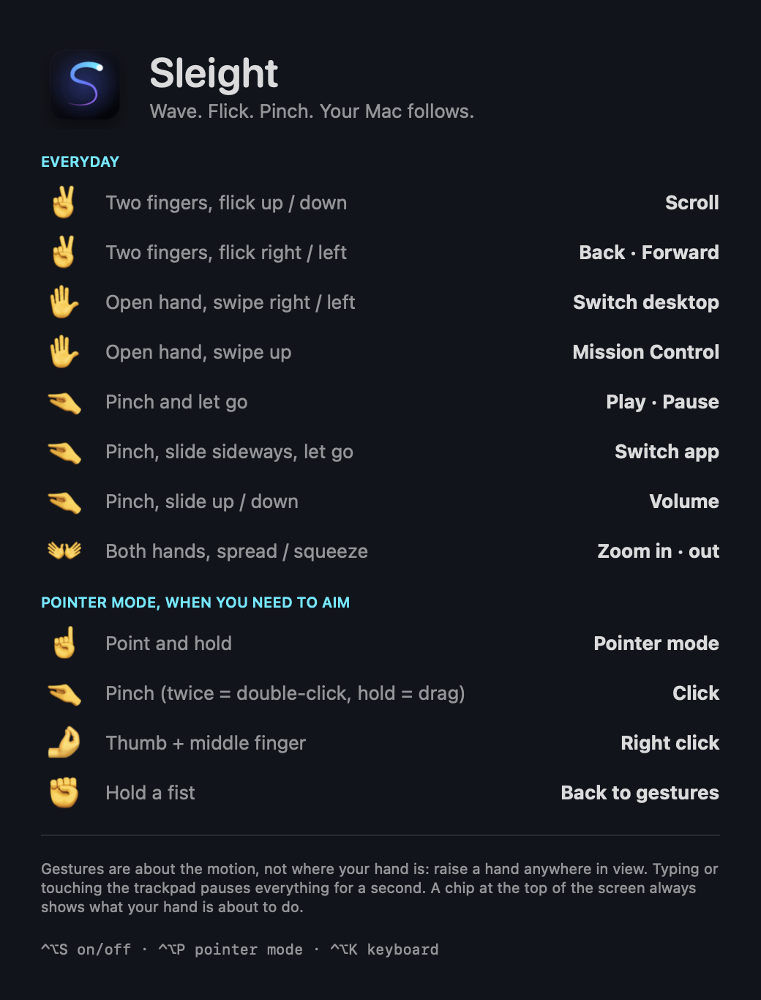

<p align="center"></p>

<p align="center"><b>Wave. Flick. Pinch. Your Mac follows.</b><br>
Camera hand gestures for macOS: a handful of easy gestures, two hands, and no aiming.</p>

---

Sleight watches your hands through the Mac's camera and turns a few natural motions
into the things you do all day: scroll, go back, switch desktops and apps, play/pause,
volume and zoom. Gestures depend on **what your hand is doing, not where it is**, so you
can raise a hand anywhere in view and flick. When you do need to aim, point and hold to
get a cursor, then make a fist to put it away.

It is a native Swift menu bar app. Apple's Vision hand-pose model runs on the Neural
Engine (~8 ms per frame), events go straight to the window server, and no frame ever
leaves the Mac.

## Gestures

<p align="center"></p>

The design rules:

- **Shape picks the family, motion picks the action.** Three shapes cover everyday
  use: ✌️ (scroll, back/forward), ✋ (desktops, Mission Control), 🤏 (media and apps).
  They're easy to make and impossible to confuse.
- **Trackpad muscle memory.** Two fingers scroll and go back/forward; a whole hand
  switches desktops; content follows your hand, with natural scrolling.
- **Flicks, not positions.** A scroll is a flick with momentum, so flick again to go
  further. You never hold your hand at an exact spot.
- **Nothing destructive.** No gesture closes, quits or deletes anything.
- **Aiming is opt-in.** The pointer is a separate mode (☝️ hold), because aiming takes
  concentration and everyday gestures shouldn't.
- **Both hands, either hand.** Every one-hand gesture works with either hand. Two open
  hands spread or squeezed = zoom.

### Always know what's about to happen

<p align="center"></p>

A small chip at the top of the screen shows what the hand in view will do *before*
you act ("Flick to scroll", "Pinch: let go = play/pause, slide = apps / volume"), and
flashes a confirmation when something fires. Turn the hints off in the menu once you
know them; the confirmations stay.

### Pointer mode

Hold ☝️ for half a second. The cursor follows your palm (not a fingertip, so pinching
doesn't move it). Pinch to click, pinch twice to double-click, pinch-hold-move to drag,
thumb + middle finger to right-click, ✌️ flick to scroll. Hold a fist to go back. A small
bar appears with big **Keyboard** and **Exit** buttons.

<p align="center"></p>

The keyboard is a full Mac layout with **⌘ ⌥ ⌃ ⇧**: tap a modifier for the next key,
double-tap to lock it, so shortcuts like ⌘C, ⌘⇧T or ⌥← work. It never takes
focus, so keys type into the app you were in. Keys are big hand-pointing targets and
highlight on hover.

| Hotkey | |
|---|---|
| `⌃⌥S` | Gestures (and the camera) on / off |
| `⌃⌥P` | Pointer mode on / off |
| `⌃⌥K` | On-screen keyboard |

## Install / build

Requires macOS 15+, Xcode (Swift 6), Apple silicon.

```bash
./scripts/build-app.sh          # builds, renders the icon, signs, installs ~/Applications/Sleight.app
open ~/Applications/Sleight.app
```

The first launch asks for **Camera** and **Accessibility** (to post scroll, key and
click events). The build signs with your Apple Development certificate when there is
one, so the grants survive rebuilds.

```bash
swift test                      # 59 engine tests, no camera needed
```

| Launch flag (`open -n ~/Applications/Sleight.app --args …`) | |
|---|---|
| `--bench 10` | Real camera pipeline for 10 s, no events posted; writes `benchmark.txt` |
| `--record 20` | Record 20 s of hand landmarks (no images) to `recordings/*.jsonl` |
| `--selftest` | Permissions, and that Sleight's own events aren't mistaken for yours |
| `--snapshots DIR` | Render the chips, keyboard, guide and logo to PNGs |

Data lives in `~/Library/Application Support/Sleight/`.

## Speed

Measured on an M4 Pro with the built-in camera, normal light (`--bench`):

| Stage | Cost |
|---|---|
| Camera (exposure + Apple's image pipeline, until the frame reaches the app) | ~72 ms, hardware |
| Vision hand pose, Neural Engine, 640×480 | **7.8 ms** mean, 12 ms p95 |
| Tracking + gesture engine | < 0.1 ms |
| Event posting (own high-priority queue) | < 1 ms |

The software part is ~9 ms. What Sleight does to protect it: 640×480 instead of 1080p
(Vision went from 17.6 to 7.8 ms), frame rate **pinned** at 30 so low light can't halve
it, late frames dropped rather than queued, flicks detected mid-motion (the action
fires while your hand is still moving), and 120 Hz output smoothing between 30 fps
frames. An iPhone via Continuity Camera (60 fps, pick it in the menu) cuts the camera
term.

## What makes it practical

| Problem | What Sleight does |
|---|---|
| Hand **entering the frame** looks like a swipe | Motion only counts if the hand was already in view and settled. |
| **Return stroke** after a flick (hand coming back) | The opposite direction is locked out for 0.6 s; one long motion is one flick. |
| **Hands resting on the keyboard** | The bottom of the frame is ignored, and any real key or trackpad input pauses everything for 1 s. |
| **Talking with your hands** | Slow or wandering motion never fires; flicks need speed, distance and one dominant axis. |
| **Shape flicker** between frames | A new shape must persist before it counts; pinch closes instantly but opens with hysteresis. |
| **⌘ stuck down** in the app switcher | Losing the hand or touching the keyboard mid-switch cancels it cleanly. |
| **Ghost hands** in dark rooms | Low-confidence detections are rejected (a real dark-room recording is a regression test). |
| **Background people** | Tiny hands are ignored; the hand doing a gesture keeps it even if another appears. |
| **macOS camera effects** | Gesture reactions (✌️ = balloons) and Center Stage are disabled for Sleight's camera. |
| **Distance from the camera** | Everything is measured in hand-lengths. |
| Pointer-mode precision | Palm anchor + One Euro filter + acceleration + precision mode + click rewind + drag deadzone. |
| Lost tracking in pointer mode | Short dropouts bridged; longer ones release held buttons, then exit. |

## Architecture

```
Sources/
  SleightCore/        pure logic, unit tested
    HandPose            per-frame features and the five shapes
    HandTracks          up to two hands across frames: filtering, debounced shape and pinch
    Flick               deliberate-flick detector (settle, dominance, return-stroke lockout)
    CommandEngine       everyday gestures
    PointerEngine       pointer mode
    SleightEngine       mode switching, real-input override
  Sleight/            the app: camera, Vision, output (glide, momentum, media keys, ⌘-Tab),
                      input monitor, overlay chip + ring + intro, mode bar, keyboard,
                      menu bar, settings, guide, preview & tuning
  SleightBrand/       the logo, drawn in code
Tests/SleightCoreTests  59 tests, including a real dark-room replay
```

## The name and the mark

*Sleight*, as in sleight of hand: quick, deft, a little bit of magic. The mark is an
**S** drawn as one flick of a fingertip: a faint tail that grows into a bright head,
through a magenta → indigo → cyan gradient, with faint HUD rings behind it. When
Sleight turns on, the mark draws itself on screen.

See [ROADMAP.md](ROADMAP.md).
