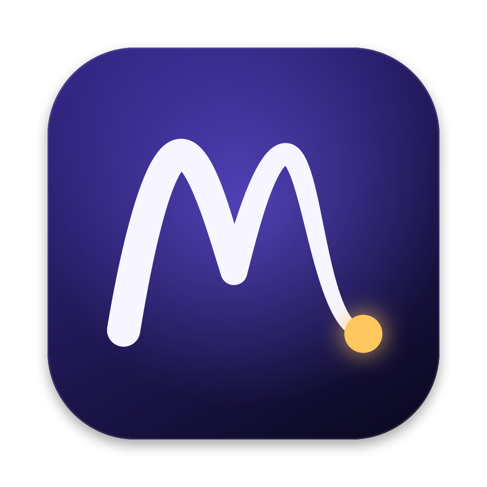
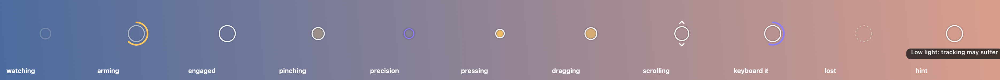

<p align="center"></p>

<h1 align="center">Maestro</h1>
<p align="center"><b>Conduct your Mac with one hand.</b><br>
Camera-based hand gestures for macOS, built for low latency first.</p>

---

Maestro watches your hand through the Mac's camera and turns it into a pointer,
clicks, drags, scrolling, Space switching and an on-screen keyboard. It is a native
Swift menu bar app: Apple's Vision hand-pose model runs on the Neural Engine, events
go straight to the window server, and no frame ever leaves the machine.

The logo is one baton stroke that draws an **M**: two arches fall into the *ictus*
(the point where a conductor's beat lands), then the stroke sweeps out and lands on
the gold dot, the beat, which is what a pinch is.

## Gestures

| Gesture | Does |
|---|---|
| ✋ Open palm, held still ~0.3 s | **Engage** (a gold ring fills around the cursor) |
| Move hand | Move the pointer. Slow = fine (ring shrinks, turns violet), fast = far |
| 🤏 Thumb + index pinch | **Click**. Twice quickly = double-click. Pinch-hold-move = **drag** |
| Thumb + middle pinch | **Right click** |
| ✊ Fist, then move | **Scroll** (grab the page). Let go mid-motion to coast |
| Flick open palm ← / → | Switch **Spaces** (content follows your hand, like the trackpad) |
| Flick open palm ↑ | **Mission Control** |
| ✌️ Peace sign, hold 0.6 s | Toggle the **on-screen keyboard** |
| Drop hand · show back of hand · touch keyboard/trackpad | **Rest**: Maestro steps aside instantly |
| `⌃⌥M` | Turn hand control (and the camera) on/off |

<p align="center"></p>

The ring around the cursor always tells you what Maestro thinks is happening:
watching, arming, engaged, pinch closing (it contracts *before* the click so you can
see a click coming), precision, pressed, dragging, scrolling, keyboard gesture,
tracking lost, and hints such as low light.

<p align="center"></p>

The keyboard floats without taking focus, so pinching a key types into whatever app
you were in. Keys are large on purpose (hand-pointing targets) and highlight on
hover, so you see what a pinch will hit before you make it.

## Install / build

Requires macOS 15+, Xcode (Swift 6), Apple silicon.

```bash
./scripts/build-app.sh          # builds, renders the icon, signs, installs ~/Applications/Maestro.app
open ~/Applications/Maestro.app
```

The first launch asks for **Camera** and **Accessibility** (needed to move the cursor
and click). The build signs with your Apple Development certificate if one exists,
so those grants survive rebuilds. With ad-hoc signing macOS forgets them on every build.

```bash
swift test                      # 50 engine tests, no camera needed
```

Useful launch flags (`open -n ~/Applications/Maestro.app --args …`):

| Flag | What it does |
|---|---|
| `--bench 10` | Run the real camera pipeline for 10 s without posting events; writes `benchmark.txt` |
| `--record 20` | Record 20 s of hand landmarks (no images) to `recordings/*.jsonl` |
| `--selftest` | Check permissions and that Maestro's own events are not mistaken for yours |
| `--snapshots DIR` | Render the HUD, keyboard and guide to PNGs |

Everything lives in `~/Library/Application Support/Maestro/` (config, benchmark,
recordings).

## Why it should feel fast

Latency budget, measured on an M4 Pro with the built-in camera:

| Stage | Cost | What Maestro does about it |
|---|---|---|
| Camera exposure + image processing | ~35–70 ms (hardware) | 640×480 instead of 1080p, frame rate **pinned at 30** so low light can't halve it |
| Frame queueing | 0 ms | Late frames are dropped, never queued |
| Vision hand pose | **~10 ms** (Neural Engine) | Small frames, max two hands |
| Filtering + gesture engine | < 0.1 ms | Pure Swift value types, no allocation in the hot path |
| Event posting | < 1 ms | Straight to the HID event tap on a dedicated high-priority queue |
| 30 fps → 120 Hz display | 0 ms added | Each step is applied half at once and half glided at 120 Hz |

`--bench` in a pitch-dark room measured: Vision 10.3 ms mean, 18 ms p95; camera
delivery ~69 ms (dark = the longest exposures). Run it again in normal light: that
number is the main one to watch. An iPhone over Continuity Camera (60 fps) roughly
halves the camera term; pick it from the menu bar.

## Problems I anticipated, and the fix for each

| Problem | Fix |
|---|---|
| **Jitter vs. lag** | One Euro filter: heavy smoothing when slow, almost none when fast. Tunable live. |
| **Pinching moves the cursor** ("click lands 5 px off") | The cursor follows a palm *anchor* (wrist + knuckles), not a fingertip, so finger motion barely moves it. On top of that, when a pinch closes the cursor **rewinds** to where it was when the fingers started closing. |
| **Click vs. drag** | After a pinch, the cursor holds still until you move past a deadzone (9 pt). Small wobble = clean click; real motion = drag. |
| **Pinch flicker** (double clicks from one pinch) | Hysteresis: closes below 0.25 hand-lengths, opens only above 0.38, and must read open for 2 frames. |
| **Precision for small targets** | Pointer acceleration (slow = fine, fast = far) **plus** a precision mode that eases in when you nearly stop (0.4× gain, violet ring). |
| **Distance from camera** | Everything is measured in *hand-lengths*, so behaviour is identical whether you sit 40 or 90 cm away. |
| **Running out of camera view** (relative mode) | Edge glide: at the edge of the camera frame, while still pushing outward, the cursor keeps travelling. |
| **Resting state vs. action** ("Midas touch") | Nothing happens until you deliberately hold an open palm still. A hand passing through, a fist, or relaxed fingers never engage. |
| **Talking with your hands / typing** | Any real keyboard or trackpad input disengages instantly and blocks re-engaging for 1 s, and the HUD hides. Our own synthetic events are tagged so they are never mistaken for yours (verified by `--selftest`). |
| **Turning away** | Showing the back of your hand disengages, and it can't re-engage until the palm faces the camera again. Orientation is self-calibrated at engagement, no left/right guessing. |
| **Dropping the hand** | Disengages, and the downward motion of the exit is rewound so the cursor stays where you left it. |
| **Lost tracking** (blur, occlusion) | Dropouts under 250 ms are bridged seamlessly with the cursor frozen (never extrapolated). Longer ones **release any held mouse button** (no stuck drags), then disengage at 1.2 s. |
| **Tracker glitches / someone else's hand** | Maestro locks onto the engaged hand; jumps larger than 2.5 hand-lengths in one frame are ignored. Tiny background hands are ignored. |
| **Ghost hands in the dark** | Observed for real: in a dark room Vision "saw" a hand in 80% of frames. Hands with low mean joint confidence are rejected. A recording of that room is a regression test that must never engage. |
| **Low light** | Frame rate is pinned (so frames get darker rather than fewer); brightness is monitored and the HUD says "Low light" / "Camera is slow". |
| **Fist vs. pinch confusion** | A pinch requires the index finger to be partly extended; a fist requires it folded. They cannot both be true. |
| **Swipes vs. fast pointing** | Swipes need a very fast open-palm flick (7 hand-lengths/s over ≥1.3 hand-lengths, axis-dominant). The cursor motion during the flick is rewound, and the return stroke is ignored. |
| **Stepping on a 120 Hz display** | Output glide (see latency table). |
| **Multiple displays / lid closed** | Cursor is clamped to the real display layout (L-shapes included); camera falls back automatically when a device disappears. |
| **Accidentally locking your trackpad** | The system's 0.25 s post-synthetic-event suppression is disabled. |
| **Battery** | Camera runs only while enabled (`⌃⌥M`). Idle frame-rate drop is on the roadmap. |

## Architecture

```
Sources/
  MaestroCore/      pure logic, no AppKit/Vision: unit tested
    HandFrame         21 joints, mirrored, aspect-correct coordinates
    HandPose          features: anchor, scale, finger extension, pinch, orientation
    OneEuroFilter     adaptive smoothing
    GestureEngine     state machine: idle → arming → engaged, gestures, rewinds, loss handling
    Config            every threshold, in hand-lengths, documented
    SyntheticHand     anatomically plausible fake hands for tests
  Maestro/          the app
    CameraCapture     format/fps selection, frame-rate lock, device fallback
    HandTracker       Vision → HandFrame, luma probe
    Pipeline          capture queue: Vision → engine → output; stats, benchmark, recording
    OutputDriver      own queue: 120 Hz glide, scroll smoothing + momentum, system actions
    EventInjector     CGEvent posting, tagged
    InputMonitor      listen-only event tap for real input; Carbon hotkey
    Overlay           click-through HUD on every display, driven by CADisplayLink
    KeyboardPanel     non-activating on-screen keyboard
    Preview/Settings/Guide windows, menu bar, snapshots
  MaestroBrand/     the logo, drawn in code (icon, menu bar glyph)
Tests/MaestroCoreTests  50 tests incl. a real dark-room replay
```

## Tuning

Menu bar → **Camera Preview & Tuning…** shows the live skeleton and every number the
engine uses (pinch distance, finger extension ratios, orientation, confidence, fps,
latency). **Settings…** exposes the important knobs live; everything else is in
`config.json`. **Record 20 s** saves your real hand movements so they can be replayed
through the engine as tests.

See [ROADMAP.md](ROADMAP.md) for what's next.
