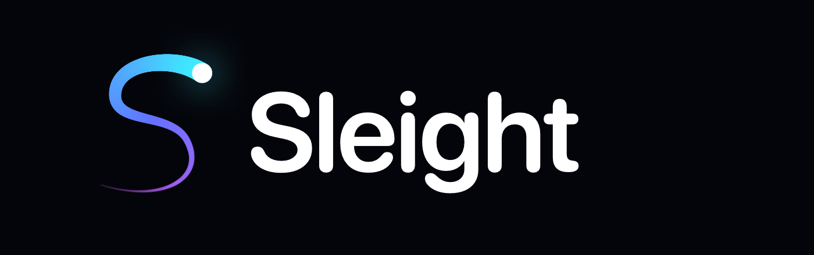
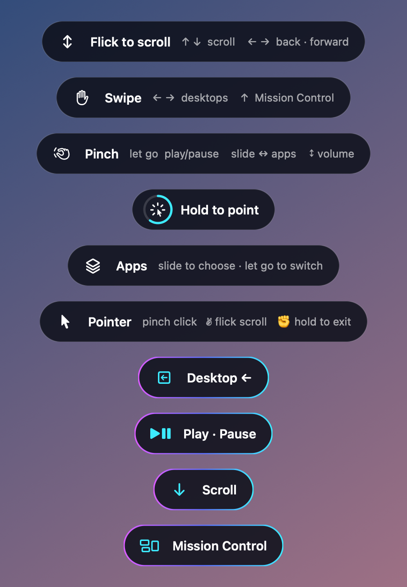
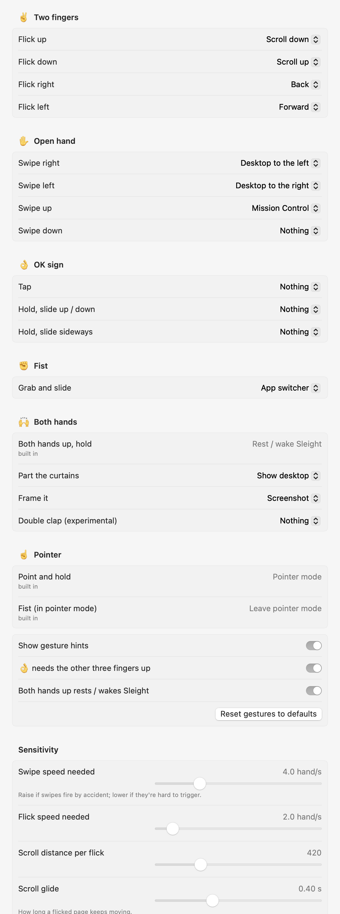
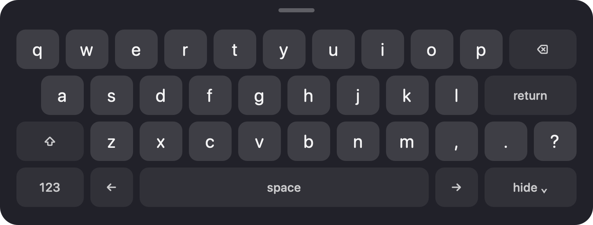

<p align="center"></p>

<p align="center"><b>Gestures that land.</b><br>
Camera hand gestures and voice commands for macOS: a handful of easy gestures, both hands, no aiming.</p>

<p align="center">
  <a href="https://github.com/ArfiArfath21/sleight/releases/latest"></a>
  
  <a href="LICENSE"></a>
  <a href="https://ko-fi.com/arfiarfath21"></a>
</p>

<p align="center">
  <a href="#install"></a>
</p>

<p align="center">
  
</p>

---

Sleight watches your hands through the Mac's camera and turns a few natural motions
into the things you do all day: scroll, go back, switch desktops and apps, show the
desktop, take a screenshot, and anything else you assign. Gestures depend on **what your hand is doing, not where it is**, so you
can raise a hand anywhere in view and flick. When you do need to aim, point and hold to
get a cursor, then make a fist to put it away.

For things a gesture can't name, say it: **"Jarvis, switch to Claude"**.

It is a native Swift menu bar app. Apple's Vision hand-pose model runs on the Neural
Engine (~8 ms per frame), speech is recognised on-device, events go straight to the
window server, and no frame or sound ever leaves the Mac.

## Gestures: Sleight recognises, you decide

Sleight's job is **recognition**: telling a deliberate flick from a wave, an OK sign from
a relaxed hand, a grab from a fist that's just resting. **What each gesture does is
yours**: every gesture has a menu of ready-made actions in **Settings**.

<p align="center"></p>

| Gesture | Default |
|---|---|
| ✌️ flick up / down | Scroll down / up (with momentum) |
| ✌️ flick right / left | Back / Forward |
| ✋ swipe right / left | Desktop to the left / right |
| ✋ swipe up / down | Mission Control / Nothing |
| 👌 tap · hold+slide ↕ · hold+slide ↔ | Nothing (pick media, tabs, zoom, arrow keys…) |
| ✊ grab and slide sideways | App switcher |
| 🖐🖐 part the curtains | Show desktop |
| Frame with two L-shaped hands | Screenshot |
| 👏👏 double clap (experimental) | Nothing |
| **Both hands up, held** | **Rest / wake Sleight** (built in) |
| **☝️ point and hold** | **Pointer mode** (built in) |
| **✊ fist in pointer mode** | **Leave pointer mode** (built in) |

One-shot gestures can be set to scroll, back/forward, tabs, desktops, Mission Control,
show desktop, previous app, hide/minimize/full screen, media keys, zoom, arrow keys,
screenshots, Spotlight, lock screen, the on-screen keyboard, or rest/wake. Slide
gestures (✊ and 👌 hold-and-slide) step through the app switcher, volume, tabs, zoom,
desktops, arrow keys or brightness, one step per stretch of travel.

**Gestures set to Nothing aren't even looked for**, so an unused gesture can never
misfire or get in the way of the ones you use. That's also why media isn't on by
default: a pinch is the easiest gesture to make by accident.

Design rules for the recognisers:

- **Motion and shape, never position.** Raise a hand anywhere in view.
- **Flicks, not holds.** A scroll is a flick with momentum; flick again to go further.
- **Deliberate over easy.** A media pinch is an OK sign closed from open fingers; a swipe
  must start from a hand already in view; a return stroke never counts.
- **Aiming is opt-in.** The pointer is its own mode, because aiming takes concentration.

### Rest and wake

Raise both open hands, palms to the screen and shoulder-width apart, as if saying "hold
on", and keep them still for a second: a ring fills, and Sleight **rests**. The camera
keeps watching, but nothing you do triggers anything except the same gesture, which
wakes it. `⌃⌥S` does the same; turning the camera fully off is a separate menu item.

A double clap can do it too (Settings, experimental, off by default): at the moment of
a clap the hands are edge-on and hide each other, so the camera alone misses many.

### Practice

**Menu → Practice Gestures…** opens a window with the live camera and your hand
skeleton, every gesture explained in plain words with what it's currently set to, and
a counter that lights up each time one is recognised (even gestures set to Nothing).
Nothing happens on your Mac while it's open. It also records
hand landmarks (positions only, no video) to `recordings/practice-*.jsonl`, so
thresholds can be tuned against real hands.

### 👌 without false triggers

When assigned, 👌 is an **OK sign** (thumb and index tips touching, other three fingers
up) that **closes from open fingers**: a relaxed hand that merely looks pinched never
qualifies. Sliding needs the pinch held still for a beat first, and a pinch made while
the hand is moving is ignored.

### Always know what's about to happen

<p align="center"></p>

A small chip at the top of the screen shows what the hand in view will do *before*
you act, listing your own assignments ("Flick ↑ scroll down ↓ scroll up → back"), and
flashes a confirmation when something fires. Turn the hints off in the menu once you
know them; the confirmations stay.

### Pointer mode

Hold ☝️ for half a second. The cursor follows your palm (not a fingertip, so pinching
doesn't move it). Pinch to click, pinch twice to double-click, pinch-hold-move to drag,
thumb + middle finger to right-click, ✌️ flick to scroll. Hold a fist to go back. A small
bar appears with big **Keyboard** and **Exit** buttons, and clicking into any text field
**brings the keyboard up by itself** (Sleight asks Accessibility what you clicked).

<p align="center"></p>

The keyboard is a full Mac layout with **⌘ ⌥ ⌃ ⇧**: tap a modifier for the next key,
double-tap to lock it, so shortcuts like ⌘C, ⌘⇧T or ⌥← work. It never takes
focus, so keys type into the app you were in. Keys are big hand-pointing targets and
highlight on hover.

| Hotkey | |
|---|---|
| `⌃⌥S` | Rest / wake (camera keeps watching) |
| `⌃⌥P` | Pointer mode on / off |
| `⌃⌥K` | On-screen keyboard |
| `⌃⌥V` | Speak one command (push to talk) |

## Voice commands

Hands are best for quick, continuous things (scrolling, flicking, sliding). Voice is
best for things with a name. Voice is on by default and the wake word is **Jarvis**:

| Say | Does |
|---|---|
| "Jarvis, camera on" · "camera off" | Starts or stops the camera. It starts **off**, and switches itself off after 5 minutes with no hands |
| "Jarvis, switch to Claude" · "open Safari" · "quit Slack" | Any app: brings it forward (opening it if needed) or quits it |
| "Jarvis, export as PDF" · "new Finder window" | **Any menu command of the app in front**, by its name |
| "Jarvis, scroll down" · "go back" · "next tab" · "mission control" | Any action in the gesture list |
| "Jarvis, undo" · "copy" · "paste" · "save" · "close tab" · "reload" · "press enter" | Everyday shortcuts and keys |
| "Jarvis, next tab twice" · "undo 3 times" | Repeats |
| "Jarvis, pause" · "next track" · "volume 30" · "mute" | Media and volume |
| "Jarvis, open github.com" · "google best ramen" | Websites and web search |
| "Jarvis, search for invoices" | Spotlight |
| "Jarvis, run Morning Routine" | Any of your Apple Shortcuts, which makes the list open-ended |
| "Jarvis, type see you at six" | Types into whatever has focus |
| "Jarvis, rest" · "wake up" | Rests gestures and voice; while resting only "wake up" works |

You can also say "Jarvis", pause, then the command. A chip shows what it heard as you
speak. `⌃⌥V` takes one command without the wake word, even with voice off.

- **Why Jarvis:** speech in 8 voices through the on-device recogniser came back as
  "Jarvis" 47 times out of 48 and as "Sleight" 0 times ("slide", "slight", "paste
  light"). Computer, Friday and "hey Sleight" are in Settings.
- **Context:** the recogniser is primed with what makes sense right now (your apps,
  your Shortcuts, and the menu commands of the app in front), and those words are
  accepted as commands. Near misses ("camera of", "new find the window") still land.
- **Never by accident:** the wake word in the middle of a sentence ("I asked Jarvis
  yesterday") does nothing; whatever follows it must be a command.
- **On-device:** Apple's speech recogniser in on-device mode. Nothing is sent anywhere.
  The mic stays open while voice is on (the orange dot shows); push to talk if you'd
  rather it didn't.

## Install

### 1. Homebrew (recommended)

```bash
brew trust arfiarfath21/tap        # once: recent Homebrew only loads casks from trusted taps
brew install arfiarfath21/tap/sleight
```

Update with `brew upgrade sleight`, remove with `brew uninstall --cask sleight`.

### 2. One-line installer

```bash
curl -fsSL https://raw.githubusercontent.com/ArfiArfath21/sleight/main/install.sh | bash
```

### 3. Download

Grab `Sleight.dmg` from the [latest release](https://github.com/ArfiArfath21/sleight/releases/latest)
and drag Sleight to Applications.

### 4. Build from source

Requires macOS 15+, Xcode (Swift 6), Apple silicon.

```bash
./scripts/build-app.sh          # builds, renders the icon, signs, installs ~/Applications/Sleight.app
./scripts/package-dmg.sh        # build/Sleight.dmg for releases
```

The first launch asks for **Camera** and **Accessibility** (to post scroll, key and
click events). The build signs with your Apple Development certificate when there is
one, so the grants survive rebuilds.

```bash
swift test                      # 85 engine tests, no camera needed
```

| Launch flag (`open -n ~/Applications/Sleight.app --args …`) | |
|---|---|
| `--bench 10` | Real camera pipeline for 10 s, no events posted; writes `benchmark.txt` |
| `--record 20` | Record 20 s of hand landmarks (no images) to `recordings/*.jsonl` |
| `--selftest` | Permissions, and that Sleight's own events aren't mistaken for yours |
| `--snapshots DIR` | Render the chips, keyboard, guide and logo to PNGs |

Data lives in `~/Library/Application Support/Sleight/`.

## Speed

Measured on an M4 Pro with the built-in camera, normal light (`--bench`):

| Stage | Cost |
|---|---|
| Camera (exposure + Apple's image pipeline, until the frame reaches the app) | ~72 ms, hardware |
| Vision hand pose, Neural Engine, 640×480 | **7.8 ms** mean, 12 ms p95 |
| Tracking + gesture engine | < 0.1 ms |
| Event posting (own high-priority queue) | < 1 ms |

The software part is ~9 ms. What Sleight does to protect it: 640×480 instead of 1080p
(Vision went from 17.6 to 7.8 ms), frame rate **pinned** at 30 so low light can't halve
it, late frames dropped rather than queued, flicks detected mid-motion (the action
fires while your hand is still moving), and 120 Hz output smoothing between 30 fps
frames. An iPhone via Continuity Camera (60 fps, pick it in the menu) cuts the camera
term.

## What makes it practical

| Problem | What Sleight does |
|---|---|
| Hand **entering the frame** looks like a swipe | Motion only counts if the hand was already in view and settled. |
| **Return stroke** after a flick (hand coming back) | The opposite direction is locked out for 0.6 s; one long motion is one flick. |
| **Hands resting on the keyboard** | The bottom of the frame is ignored, and any real key or trackpad input pauses everything for 1 s. |
| **Talking with your hands** | Slow or wandering motion never fires; flicks need speed, distance and one dominant axis. |
| **Shape flicker** between frames | A new shape must persist before it counts; pinch closes instantly but opens with hysteresis. |
| **⌘ stuck down** in the app switcher | Losing the hand or touching the keyboard mid-switch cancels it cleanly. |
| **Accidental media** | OK sign required, closed from open fingers, held still before sliding. |
| **Flicks near the bottom of the frame** | A flick that starts in view is followed even when it carries the hand into the ignored keyboard zone. |
| **Wrist-snap flicks** | Flicks are measured between the palm and the fingertips, so a snap of the wrist counts. |
| **Voice firing on conversation** | The wake word must be followed by a command it knows; unknown sentences are dropped, and the wake word mid-sentence never fires. |
| **HUD in your screenshot** | Sleight's own overlay is excluded from screen capture and sharing. |
| **Ghost hands** in dark rooms | Low-confidence detections are rejected (a real dark-room recording is a regression test). |
| **Background people** | Tiny hands are ignored; the hand doing a gesture keeps it even if another appears. |
| **macOS camera effects** | Gesture reactions (✌️ = balloons) and Center Stage are disabled for Sleight's camera. |
| **Distance from the camera** | Everything is measured in hand-lengths. |
| Pointer-mode precision | Palm anchor + One Euro filter + acceleration + precision mode + click rewind + drag deadzone. |
| Lost tracking in pointer mode | Short dropouts bridged; longer ones release held buttons, then exit. |

## Architecture

```
Sources/
  SleightCore/        pure logic, unit tested
    HandPose            per-frame features and the five shapes
    HandTracks          up to two hands across frames: filtering, debounced shape and pinch
    Flick               deliberate-flick detector (settle, dominance, return-stroke lockout)
    Mapping             gesture slots, the action list, defaults, action → OS events
    Voice               wake words, spoken commands → intents, fuzzy app / menu / shortcut matching
    CommandEngine       one-hand recognisers (skips gestures set to Nothing)
    TwoHandGestures     hands up (rest/wake), curtains, frame, double clap
    PointerEngine       pointer mode
    SleightEngine       active/resting, mode switching, real-input override
  Sleight/            the app: camera, Vision, output (glide, momentum, media keys, ⌘-Tab),
                      input monitor, voice listener (on-device speech), app, menu and
                      Shortcuts indexes,
                      overlay chip + ring + intro, mode bar, keyboard,
                      menu bar, settings, guide, preview & tuning
  SleightBrand/       the logo, drawn in code
Tests/SleightCoreTests  98 tests, including a real dark-room replay
```

## The name and the mark

*Sleight*, as in sleight of hand: quick, deft, a little bit of magic. The mark is a faint
ring (the camera's view, the stage), one pen stroke sweeping around it, and the gold
point where the motion lands: the moment a gesture becomes an action. Ivory and gold on
ink. When Sleight turns on, the stroke sweeps around the ring and lands on the point.

See [ROADMAP.md](ROADMAP.md).

## Support

If Sleight is useful to you, you can buy me a coffee:

<p align="center">
  <a href="https://ko-fi.com/arfiarfath21"></a>
</p>

## License

[MIT](LICENSE) © 2026 Arfath Ahmed Syed
